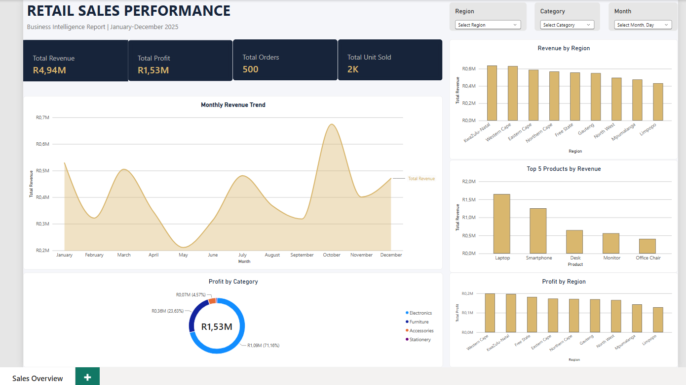

# Retail Sales Performance Analytics Dashboard

## Project Overview
This project focuses on analysing retail sales data and developing an interactive Power BI dashboard to monitor business performance.

The dashboard provides insights into revenue, profit, sales volume, product performance and regional performance.

## Business Objectives
- Monitor total revenue and profit.
- Analyse monthly revenue trends.
- Compare sales performance across regions.
- Identify profitable product categories.
- Identify the top five products by revenue.
- Allow users to interact with the data using filters.

## Tools and Technologies
- Microsoft Power BI
- DAX (Data Analysis Expressions)
- Power Query
- CSV dataset

## Dashboard Features
- Total Revenue KPI
- Total Profit KPI
- Total Orders KPI
- Total Units Sold KPI
- Monthly Revenue Trend
- Revenue by Region
- Profit by Category
- Top 5 Products by Revenue
- Profit by Region
- Interactive Region and Category slicers

## Dataset
The project uses a synthetic retail sales dataset containing 500 records across 2025.

The dataset includes order dates, customers, regions, products, categories, quantities, unit prices, unit costs and discounts.

## Skills Demonstrated
- Data cleaning and preparation
- Data modelling fundamentals
- DAX calculations
- Data visualisation
- Business intelligence reporting
- Dashboard development

## Project Status
Power BI dashboard completed and tested.
## Dashboard Preview

